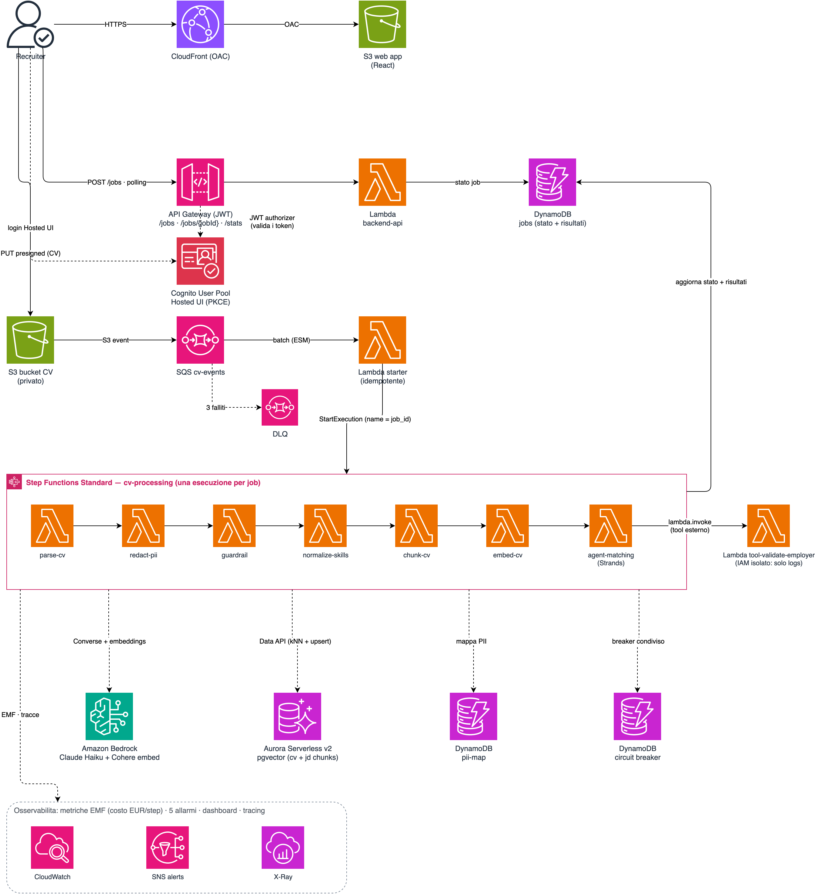

# skill-bridge

CV parsing and job-description matching system on AWS — serverless pipeline
(S3, SQS, Step Functions, Bedrock, Aurora pgvector) with a React web app.

## Architecture

*The diagram source is [`assets/architecture.drawio`](assets/architecture.drawio) — the PNG embeds the XML, so opening it in draw.io recovers the editable diagram.*

## What's been built

### Upload and job tracking
- React web app (Vite + TypeScript) on a private S3 bucket behind CloudFront (OAC):
  drag & drop CV upload (PDF/DOC/DOCX, max 4.5 MB) with client-side validation.
- Backend API on API Gateway (HTTP API) + Lambda: `POST /jobs` creates the job and
  returns an S3 presigned PUT URL (the file never transits through the backend);
  `GET /jobs/{jobId}` exposes status and results. Requests validated with Pydantic.
- Stats dashboard in the web app (behind login): stat tiles (total/completed/
  review CVs, spend and average cost per CV in EUR) plus daily bar charts of
  processed CVs and cost, aggregated by `GET /stats` from the jobs table and
  the CloudWatch EMF cost metrics.
- Authentication with Amazon Cognito: recruiters log in via the Hosted UI
  (authorization code + PKCE, no secrets in the SPA); JWTs are validated by the
  API Gateway JWT authorizer BEFORE the Lambda runs — unauthenticated requests
  get a 401 at zero cost. Jobs carry `created_by` from the verified claims.
  Accounts are admin-created (no self-signup).
- Every upload is a tracked job on DynamoDB (`PENDING_UPLOAD -> PROCESSING ->
  COMPLETED / FAILED / NEEDS_REVIEW`), with the error recorded on the job when
  something breaks: no CV is ever lost silently.
- Event flow: S3 event -> SQS (+ DLQ after 3 attempts) -> starter Lambda,
  idempotent on two levels (conditional DynamoDB transition + Step Functions
  execution name = job id, so at-least-once SQS deliveries never double-process).

### Ingestion pipeline (Step Functions Standard, one Lambda per step)
- **Parsing**: the document goes straight to a multimodal LLM on Bedrock
  (Converse document block) and comes back as markdown — handles scans and
  multi-column layouts with no local text extraction. A mandatory sanity check
  routes broken transcriptions to a human review queue (`NEEDS_REVIEW`) instead
  of letting them poison the pipeline.
- **PII pseudonymization**: double pass — deterministic regexes for structured
  Italian PII (email, phone, codice fiscale) + an SLM pass for names, addresses,
  birth dates. Values become reversible tokens (`[CANDIDATE_NAME_1]`...); the
  token->identity map lives in a dedicated encrypted table, separate from
  pipeline data. Everything downstream works on pseudonymized text.
- **Anti prompt-injection guardrail**: an SLM scans the untrusted CV text for
  hostile instructions; suspicious spans are neutralized and logged — the CV is
  never blocked (a false positive must not deny service to a candidate).
- **Skill normalization** (before chunking): two-stage matching against an
  internal taxonomy (~60 canonical skills with IT/EN aliases) — exact alias
  match first ('Phyton' -> Python), then embedding kNN + SLM choice with the
  sentence context and a legitimate "none of these" outcome. Canonical names
  are rewritten into the text (word-boundary safe); unmatched skills feed a
  taxonomy candidate queue.
- **Structural chunking**: canonical CV sections (summary, experience,
  education, skills, certifications, languages) with dates, language and a
  parsing_version for targeted re-indexing.
- **Embedding and indexing**: multilingual embeddings (Cohere embed-multilingual
  v3, same vector space as the job descriptions) upserted into Aurora
  PostgreSQL Serverless v2 + pgvector via the RDS Data API — atomic versioned
  upsert (`doc_version` / `is_latest`), no Lambda lives in a VPC, DB access is
  pure IAM. The cluster scales to zero at rest.

### Matching agent
- Strands Agents loop (Bedrock Converse under the hood): the framework drives
  the model->tool->model cycle, the governance stays in our code — budget
  checked inside the tools (steps + time axes), typed outcomes, evidence rule.
- Internal tool `search_jd`: semantic kNN over the pre-indexed job descriptions.
- External tool `validate_employer` (behind a feature flag): checks declared
  employers against a company registry (~126 companies). Decision in the agent,
  execution in an isolated Lambda whose IAM role can only write logs — the
  security boundary is permissions, not code. A shared per-source circuit
  breaker on DynamoDB (3 failures -> open, cool-down, half-open probe) protects
  a hundred parallel jobs from paying for a dead source; every failure path is
  a terminal outcome (`not_found` / `not_verifiable`), never a retry loop.
- Typed report per job: outcome (`match` / `no_match` / `not_verifiable`),
  confidence score and mandatory evidences per job description ("no evidence =
  no match" enforced in code), plus employer checks. Exposed via the API.

### Observability
- Custom CloudWatch EMF metrics from every Lambda (a shared module shipped in
  the dependencies layer — no CloudWatch API calls in the hot path): tokens,
  cost per step in EUR, per-stage quality signals (sanity failures, neutralized
  injections, unmatched skills, agent outcomes, breaker state). Measured cost:
  ~0.06 EUR per CV end-to-end.
- X-Ray tracing on all Lambdas and the state machine; the Step Functions
  execution history doubles as audit trail.
- Five actionable alarms on SNS (DLQ not empty, failed executions, breaker
  open, sanity-check spike, hourly spend threshold) + a CloudWatch dashboard
  (executions, cost per step, tokens, outcomes, quality signals, DLQ depth).

### Evaluation
- Golden set (typical / edge / adversarial — including a prompt-injection
  profile the agent must not obey) covering three stages: skill normalization
  (recall + forbidden hits), retrieval (recall@3 and MRR, measured separately
  from generation), end-to-end matching (outcome accuracy).
- Regression harness that runs the BRANCH code against real Bedrock and
  pgvector (S3 faked in memory): hard floors per metric + max regression vs a
  committed baseline; violations exit non-zero.
- Opt-in CI workflow (enable with the `EVAL_ENABLED=true` repository variable):
  runs on prompt/pipeline changes and comments the report on the PR.
  Cost: ~0.06 EUR per run.

### Infrastructure and delivery
- Everything is Terraform: reusable modules (`cv-bucket`, `frontend-hosting`,
  `backend-api`, `vectorstore`, `cv-processing`) with per-AWS-service files;
  environments are pure composition (`envs/dev`).
- CI/CD on GitHub Actions with OIDC (no static keys): plan on PR, apply on
  merge for the infra; lint/build on PR and S3 sync + CloudFront invalidation
  for the frontend; Lambda wiring (API URLs) injected at build time from
  Terraform outputs.
- Python 3.13 Lambdas with Pydantic contracts everywhere (tool-call payloads,
  inter-step artifacts, API bodies); dependencies + shared code in a single
  deterministic Lambda layer; prompts as versioned YAML files next to each
  Lambda; least-privilege IAM per component (each step reads only the previous
  step's S3 prefix and writes only its own).

## TODO

- [ ] **Company registry via external API**: replace the bundled `registry.json`
      with a real external company-registry API in `tool-validate-employer`
      (business registry / OpenCorporates-like source): HTTP call restricted to
      an egress domain whitelist, per-source circuit breaker already in place on
      the agent side, response validated against the same `EmployerValidation`
      contract, sanitization of external content unchanged. Requires the
      contractual/legal basis for the source (doc 10.3 open question).
- [ ] **JD ingestion flow via API**: replace the manual `scripts/seed_jds.py` with
      a proper ingestion flow that fetches job descriptions from an API (ATS /
      internal jobs endpoint) and upserts them into `jd_chunks` on pgvector:
      scheduled or event-driven Lambda, embedding with the shared multilingual
      model, idempotent upsert keyed on `jd_id` with versioning (same
      `doc_version`/`is_latest` pattern as `cv_chunks`), skills mapped to the
      canonical taxonomy, removal/deactivation of JDs no longer returned by the
      source.
- [ ] **Versioned taxonomy in the vector DB**: move the skill taxonomy from the
      bundled `taxonomy.json` to a `taxonomy_embeddings` table on pgvector, with a
      versioned ingestion flow (seed/update script, `taxonomy_version` on rows,
      re-embed on embedding-model change, atomic swap of the active version).
      `normalize-skills` stage 2 then switches from in-memory kNN to a DB kNN
      query, and the `[taxonomy-queue]` candidates can feed the taxonomy without
      a redeploy.
- [ ] KMS encryption + lifecycle/retention on the CV bucket; KMS CMK on the
      `pii-map` table (GDPR retention, doc section 8).
- [ ] Web app: job status polling via `GET /jobs/{jobId}` (endpoint already
      live, FE deliberately stops at upload confirmation for now).
- [ ] Restrict presigned PUT further (content-length-range via presigned POST
      or size check at parsing) — today size is validated at job creation only.
